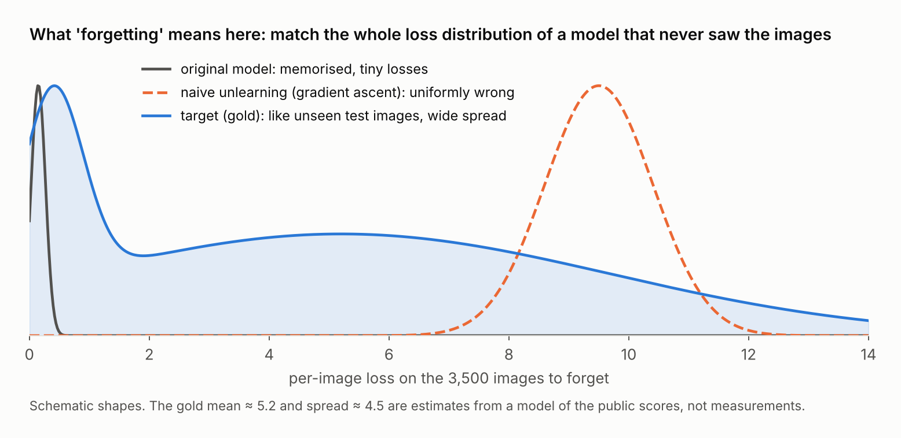

# Task 3 — Unlearning (official statement, summarised)

Supervisors: Adam Dziedzic and Franziska Boenisch. Task developed by Maitri Shah, Jack Le and Vincent Hanke
(CISPA / SprintML). Our solution: [`task3/README.md`](../../task3/README.md).

## Goal

A pretrained image classifier — a **ViT-B/16** trained on a custom 100-class dataset — and **3,500 training images
to forget**. Submit an unlearned model, derived from the given checkpoint, that behaves **as if it had never been
trained on those images**, while still performing well on the rest of the data.

## Why it is hard

A model damaged on the forget set (for example by naive gradient ascent) can have low accuracy there without having
forgotten anything meaningful: its behaviour on those images stays clearly distinguishable from a model that never
saw them. The target is a model **retrained from scratch without the forget set**: not only its confidence on the
forget images, but also *which wrong class* it picks for each one, on the exact images and on slightly altered
copies.

No labelled data is provided beyond the forget images themselves (and their labels are not given): the method must
work from the original model and the forget set alone.

## Metric

Three models: **orig** (the given `model.pt`, trained on everything), **gold** (several models retrained without the
forget images, averaged), **sub** (the submission). `L_m(x)` is the cross-entropy of model m on x with the true
label; `p_m(x)` the softmax of the logits at temperature 2.

**Utility gate**: below **70 %** accuracy on a hidden validation set, the score is 0.

**Forget quality**, computed on the forget images and on hidden altered copies of them (the two groups count
equally):

    d_sub  = |mean(L_sub)  − mean(L_gold)| + |std(L_sub)  − std(L_gold)|
    d_orig = |mean(L_orig) − mean(L_gold)| + |std(L_orig) − std(L_gold)|
    mean_std_score   = 1 − clip(d_sub / d_orig, 0, 1)
    prediction_score = 1 − clip(mean KL(p_gold ‖ p_sub) / mean KL(p_gold ‖ p_orig), 0, 1)
    forget_score     = mean_std_score × prediction_score

0 means no unlearning (sub = orig), 1 means sub matches gold. Matching only the average loss is not enough.

**Retain quality**, on a hidden control set:

    retain_accuracy_score = clip(acc_sub / acc_orig, 0, 1)
    retain_kl_similarity  = 1 / (1 + mean KL(p_orig ‖ p_sub))
    retain_score          = retain_accuracy_score × retain_kl_similarity

**Final**: `forget_score × retain_score`, so neither side can be sacrificed for the other.

## Data and submission

- `model.pt`: a weights-only state dict for timm `vit_base_patch16_224`, 100 classes, LayerScale init 1e-4.
- `forget_images.npz`: key `images`, uint8 `[3500, 224, 224, 3]`, raw pixels, **no labels**.
- `task_template.py` (model builder, server preprocessing, prediction helper, `unlearn()` stub) — shipped in
  [`task3/src/task_template.py`](../../task3/src/task_template.py).
- Submission: a float32 state dict that loads with `strict=True` into that architecture, no NaN or infinity, at most
  450 MB; adapters must be merged back. The server runs eval mode under float16 autocast.
- About **30 %** of the scoring data gives the public score, **70 %** the final ranking, split by a hash of each
  sample's identifier (an altered copy follows its source image).

## References given with the task

- M. Kurmanji, P. Triantafillou, J. Hayes, E. Triantafillou, *Towards Unbounded Machine Unlearning*, NeurIPS 2023 —
  [arXiv:2302.09880](https://arxiv.org/abs/2302.09880). Our notes: [papers/scrub_unlearning.md](../papers/scrub_unlearning.md).
- V. S. Chundawat, A. K. Tarun, M. Mandal, M. Kankanhalli, *Zero-Shot Machine Unlearning*, IEEE TIFS 2023 —
  [arXiv:2201.05629](https://arxiv.org/abs/2201.05629).
- C. Fan et al., *SalUn: Empowering Machine Unlearning via Gradient-based Weight Saliency in Both Image
  Classification and Generation*, ICLR 2024 — [arXiv:2310.12508](https://arxiv.org/abs/2310.12508).
- R. Zhang, L. Lin, Y. Bai, S. Mei, *Negative Preference Optimization: From Catastrophic Collapse to Effective
  Unlearning*, COLM 2024 — [arXiv:2404.05868](https://arxiv.org/abs/2404.05868).

## What the statement implied for us

- The score does not reward forgetting *as much as possible*: it rewards **imitating gold**, for which the forget
  images are simply test images — some still classified correctly, others wrong, with large and spread-out losses.
- Both the mean **and the standard deviation** of the loss are scored, so a loss term on the per-image
  cross-entropy is needed, not only a KL on the outputs.
- Altered copies count for half of the forget score, so forgetting has to extend to transformed versions of the
  images.
- With no retain set given, the model has to be held in place elsewhere by other means (we used COCO images as
  anchors). See [`task3/README.md`](../../task3/README.md) § 2.
