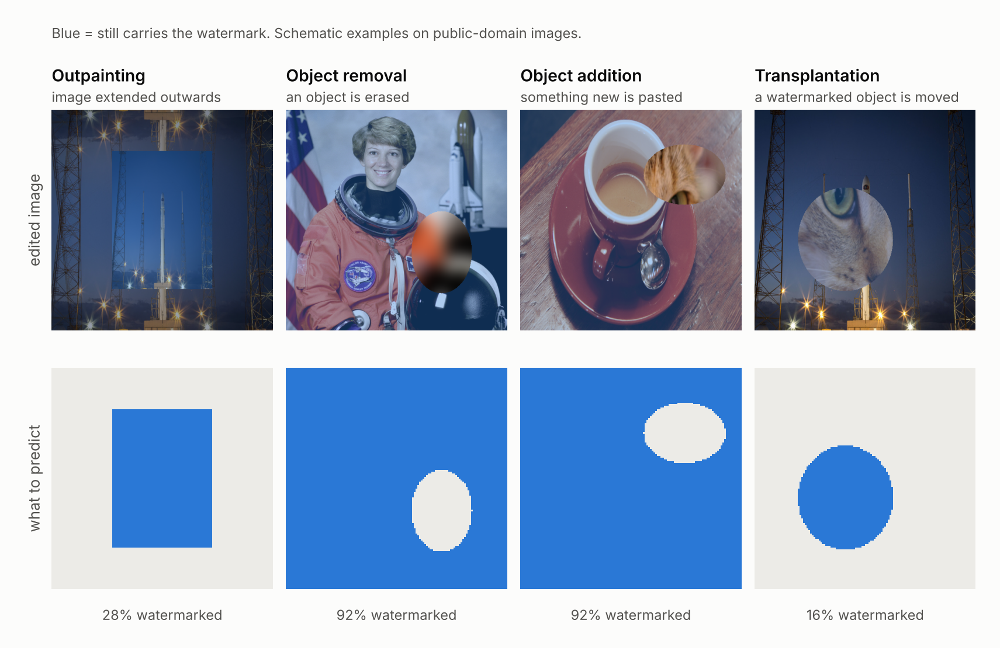
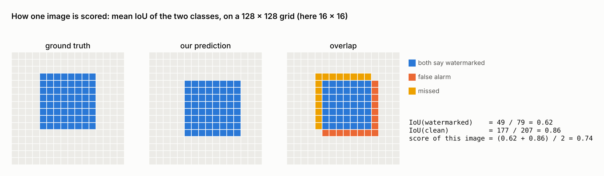
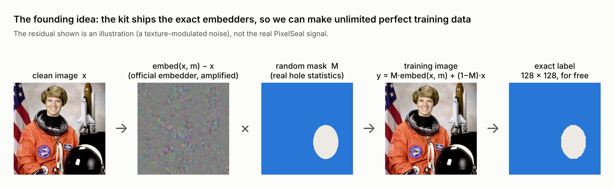
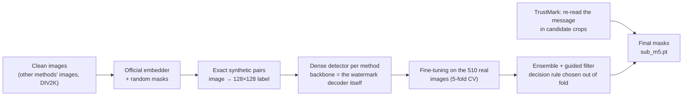
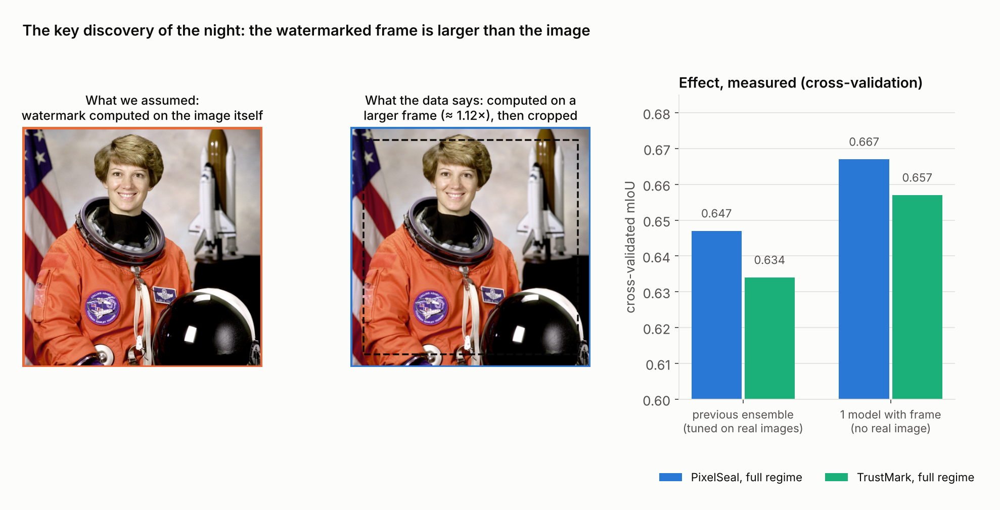
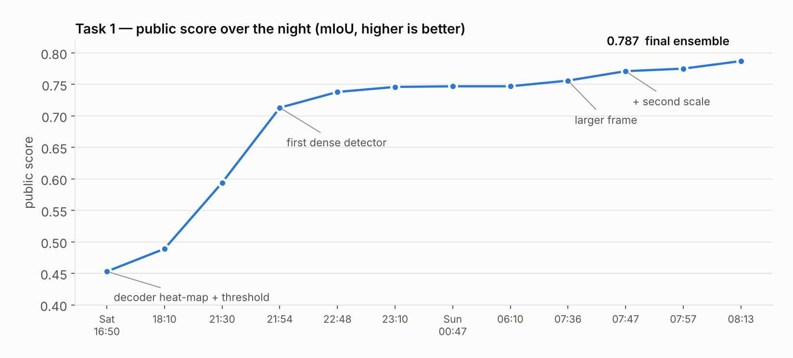

# Task 1 — Where is the watermark?

**Public score 0.787** (mean IoU) · task statement: [summary](../docs/tasks/task1_watermark_localisation.md) ·
paper it builds on: [Pixel Seal](../docs/papers/pixel_seal.md)

> Images were invisibly watermarked, then edited. Find, pixel block by pixel block, which parts still carry the
> watermark — using watermarking methods that were only ever trained to read a message from the *whole* image.

## The task in pictures

Every image was watermarked with one of three public methods (**PixelSeal**, **TrustMark**, **StegaStamp**), then
edited by a generative model in one of four ways. Our answer is a **128 × 128 grid** per image (one cell = 4 × 4
pixels), 1 where the watermark is still present.



Why it matters: if a watermark cannot be localised, an edit made by someone else is attributed to the watermark
owner — a third party could add harmful content to a watermarked image and frame its author.

Why it is hard: these methods decode one message from the whole image; none of them was built to say *where* the
watermark is. The edited regions range from half the image to a thin object, and the three methods behave very
differently. We had 510 training images with their masks, and 1,020 test images.

### How it is scored



The score of an image is the mean of the IoU of the two classes (watermarked, clean); the final score is the average
over all test images, so a small object counts as much as a large area. Predicting "all watermarked" caps an image
at 0.5.

## Our solution

### The founding idea: unlimited, perfectly labelled training data

The organisers' kit ships the **exact embedders** of the three methods. Since an edited image is
`y = M · embed(x, m) + (1 − M) · x`, we can create as many training examples as we want, with a perfect label, and
train a **dense detector** per method that says "watermarked / not watermarked" for every cell — no message needed.





Two choices made the difference:
- **The backbone is the watermark decoder itself** (PixelSeal's ConvNeXt-V2, TrustMark's ResNet-50): it already
  "sees" the invisible signal. A generic ImageNet backbone learns nothing on PixelSeal (AUC 0.5).
- **Every decision was taken on a paired 5-fold cross-validation**, never on the public score — the public score
  followed the CV at about 0.7 times the gain.

### The key discovery of the night: a larger frame

During the night our synthetic data still did not look like the real images (0.711 on synthetic versus 0.561 on real
PixelSeal holes). The cause: each image had been watermarked on a **frame larger than the image**, then
cropped it. Once our generator did the same, a model trained **without any real image** beat our best ensemble
fine-tuned on real images.



- The recomputed message pattern `embed(y, m) − embed(y, m̄)` correlates with the real image only if the image is
  completed by reflection up to a frame of side s × 512, s between 1.02 and 1.17, with any offset; about 16 % of the
  images are at s = 1. On TrustMark, the Z statistic goes from ≈ 0 to +70…+120 at the right frame; the frame is found
  for 82 % of the full train images.
- Our composites watermarked the 512 frame itself: this was the synthetic/real gap measured the night before
  (0.711 on synthetic versus 0.561 on real PixelSeal holes).
- With `--frame`, a base trained **without any real image** beats the previous ensemble fine-tuned on real images
  (PixelSeal full 0.667 versus 0.647, TrustMark full 0.657 versus 0.634).
- Second scale and frame add up: PixelSeal full ≈ 0.71, TrustMark full ≈ 0.68, objects ≈ 0.74, StegaStamp full ≈ 0.94
  in CV.

### The building blocks, in detail

1. **Dense detector per method** (`src/dense/train_dense.py`, `common.py`). The backbone is **the watermark decoder
   itself** (PixelSeal: ConvNeXtV2; TrustMark: ResNet-50) or an ImageNet ConvNeXt-tiny (StegaStamp), followed by an FPN
   and a full-resolution branch; output 128×128. Starting from the decoder is essential: a generic backbone learns
   nothing on PixelSeal (AUC 0.5).
2. **Synthetic composites** (`src/dense/gen_pairs.py`): pairs (x, embed(x, m)) on images of the same domain (images of
   the two *other* methods, DIV2K crops), then masks drawn on the fly: real train masks transformed, SAM segments,
   random shapes, and holes whose number and area follow the real distribution.
3. **Fine-tuning in 5-fold CV on the real train images** (v3), then one round of **pseudo-labels** of the test images
   (v4): the model of fold k pseudo-labels the test, and only a model that never saw fold k uses them.
4. **Ensemble** (`src/dense/assemble.py`): mean of the probability maps; **guided filter** with the colour image
   (8 settings) and decision rule (threshold, top-k, bounding box, small-component cleaning), all chosen
   **out-of-fold** per (method, predicted regime). The regime comes from the global log-likelihood of the message
   under the official decoder (`src/compute_signals.py`, right for 97 % of images).
5. **TrustMark rectangles** (`src/rect_search.py`): on the TrustMark test images predicted not full, search for the
   crop that re-reads the message; the 75 rectangles with bit accuracy ≥ 0.90 replace the map.
6. **Second scale**: a fine 128 map instead of 64 inside the detector (`--scale2`), long training on a doubled pool
   (`--with_full`), watermark strength drawn in 0.8–1.2 (`--alpha`).
7. **The watermarked frame is larger than the image** (22/11, morning) — the synthetic/real gap. Pairs are now
   watermarked on a frame of side s × 512 (s up to 1.18), completed by reflection, then cropped back
   (`gen_pairs.py --frame 0.84 --frame_max 1.18`).
8. **Ensemble m5**: second-scale + frame models fine-tuned in CV (k6) and their bases (k6b), frame base k5b,
   second-scale models v6/v6p (and v7, v7p, v8, see the reproducibility notes); StegaStamp: v3, v4, frame base k5b and k5.

## Results over the night



| Submission | Public | CV | What changed, and why |
|---|---|---|---|
| R1, no. 1081 (21/11 16:50) | 0.453 | 0.462 | 8×8 decoder map (per-position logits × message sign) + threshold per method. Guessing the regime alone is worth +0.17 (oracle 0.455); the maximum of the 8×8 map falls in the rectangle 4 % of the time: **the 8×8 map does not localise**. |
| R3, no. 1155 (18:10) | 0.489 | — | Decoding the **exact crop** of a rectangle re-reads the message (TrustMark 1.00, StegaStamp 0.97, PixelSeal 0.66) → `rect_search.py` on the 172 TrustMark test images predicted not full: 75 rectangles accepted. |
| (not submitted) | — | 0.465 | U-Net segmenter on RGB: it only learns the regime. The watermark is not visible in the pixels. |
| v1, no. 1660 | 0.594 | — | First dense detector. Bug: base images included the trained method itself, so real watermarked areas were labelled "clean". |
| **v2**, no. 1694 (21:54) | **0.713** | 0.677 | Base images = images of the **two other** methods. CV: PixelSeal 0.611, TrustMark 0.592, StegaStamp 0.826. |
| v3, no. 1820 | 0.738 | 0.709 | Fine-tuning in CV on the real train images (+0.032 paired). |
| v3 + guided filter, no. 1883 | 0.746 | 0.716 | Guided filter of the map, chosen out-of-fold (+0.0077; PixelSeal objects +0.029). |
| v3 + v4, no. 2170 (00:47) | 0.747 | 0.721 | v4 = test pseudo-labels + unwatermarked area taken from another image or blurred, 3,000 steps; mean of v3 and v4 (+0.0051). |
| + second scale, no. 3173 (06:10) | 0.747 | 0.743 (wrong) | Second-scale maps added **without folds** weighed 43 % on train and 13 % on test: the CV evaluated another ensemble than the one submitted. **Fix: a model without folds is split into a per-fold view** (`mk_folds.py`) before assembling. |
| m1_sel, no. 3491 (07:36) | 0.756 | 0.730 | First models trained on synthetic data **with a larger frame**. |
| m2b, no. 3530 (07:47) | 0.771 | 0.760 | + second-scale models v6, v6p, v7, v7p, v8. |
| m3, no. 3562 (07:57) | 0.775 | 0.763 | + second-scale bases with frame (k6b), StegaStamp with frame. |
| **m5, no. 3606 (08:13)** | **0.787** | **0.772** | Second-scale + frame models **fine-tuned in CV** (k6), frame bases and StegaStamp fine-tuning with frame. |

Every decision was taken on the **paired 5-fold CV** (per-image difference + 95 % bootstrap, `src/dense/compare_cv.py`),
never on the public score (30 % of the test, ±0.005 noise). The public score followed the CV at about 0.7 times the gain.

## What did not work

- Gaussian smoothing of the logits instead of the guided filter: +0.0000. Rectangle fitted on the predicted mask:
  −0.0002 (it never triggers on real maps). Probability calibration before top-k: −0.0016.
- More seeds of the v4 recipe: −0.0017. Second round of pseudo-labels: −0.0007.
- Blending with heads trained on internal decoder features: −0.0006. Regime read from the map: +0.000.
- StegaStamp rectangles by message re-reading: −0.0002; the dense map is already as precise.
- Message as an input (local correlation of the recomputed pattern): AUC 0.48–0.51 on real images. Replaying the
  embedder (`embed(y, m) − y`): AUC ≤ 0.74 even on synthetic data. Local matched filter with the message: AUC ≤ 0.73.
- U-Net segmenter on RGB: learns only the regime. SAM proposals alone: +0.027; SAM does not find the holes.
- Exact frame search for PixelSeal: inconclusive. Putting real images back in their frame before the detector: +0.013
  on TrustMark full alone, absorbed by the frame augmentation. Pseudo-labels on the new models, multiple views at
  inference: no gain.
- Validated in CV but **not in m5** (no time to submit): snapping non-full areas to SAM segments (+0.009), a TrustMark
  "holes" specialist (full 0.696 versus 0.678).

## Code map

| Path | Role |
|---|---|
| `config.env`, `run_all.sh`, `steps/`, `slurm/run_all.sbatch` | configuration and pipeline |
| `src/starter_kit/` | official kit: embedders and decoders (`wmloc/watermarks.py`), data loading, submission format |
| `src/t1_metric.py`, `src/test_t1_metric.py` | official metric (per-image mIoU, 512 → 128 downsampling), stratified folds, top-k; test |
| `src/compute_signals.py` | global log-likelihood of the message → regime |
| `src/rect_search.py` | watermarked-rectangle search by decoding crops |
| `src/sam/sam_feats.py` | SAM segments of every image |
| `src/dense/common.py` | paths, image pool, `MaskSampler` (real hole statistics), `DenseDet` model |
| `src/dense/gen_pairs.py` | exact synthetic pairs, optionally on a larger frame (`--frame`) |
| `src/dense/train_dense.py` | training, CV fine-tuning, pseudo-labels, second scale |
| `src/dense/mk_folds.py` | per-fold view of a model trained without folds |
| `src/dense/assemble.py`, `src/dense/compare_cv.py` | ensemble, out-of-fold rules, guided filter, rectangles; paired CV comparison |
| `src/dense/submit_file.py` | submission of a `.pt` |
| `results/` | journal of the submissions (scores, sha1, notes); the submitted `sub_m5.pt` is attached to the release `submitted-files` |

## Reproducing

This repository is first a write-up of our work; the code is the hackathon code, reorganised so that it can be
re-run on a GPU node with the official data.

<details>
<summary><b>Quick start</b></summary>

```bash
cd task1
pip install -r requirements.txt
$EDITOR config.env           # T1_DATA, T1_MODELS, T1_WORK, CONVNEXT_WEIGHTS, SAM_WEIGHTS, GPUS, PY
bash steps/00_setup.sh       # official models (internet), then checks that the data are in place
bash run_all.sh              # steps 01-12 -> $T1_WORK/out/sub_m5.pt and the CV report
bash steps/13_submit.sh      # optional: submit (needs WMLOC_API_KEY)
```
Data to provide in `$T1_DATA`:
- `release/` — the official `train.zip` and `test.zip`, unpacked with
  `python -c "from wmloc.data import unzip; unzip('train.zip', 'release'); unzip('test.zip', 'release')"`
  (run from `src/starter_kit/`);
- `clean/DIV2K_valid_HR/` — DIV2K validation images (high resolution), used for a few synthetic base images;
- `weights/convnext_tiny.safetensors` — timm ImageNet weights of ConvNeXt-tiny;
- `weights/sam_vit_h_4b8939.pth` — SAM ViT-H checkpoint (step 03, `pip install segment-anything`).

Hardware used: one node with 4 × A100 40 GB (JURECA-DC). Full pipeline: roughly 6 to 8 hours of GPU time on that
node; the pair sets take several hundred GB. Each step can be re-run alone, and `slurm/run_all.sbatch` is an example
batch script.

</details>

<details>
<summary><b>Pipeline, step by step</b></summary>

| Step | Script | What it produces (in `$T1_WORK` unless stated) |
|---|---|---|
| 00 | `steps/00_setup.sh` | official models in `$T1_MODELS`; data check |
| 01 | `steps/01_signals.sh` → `src/compute_signals.py` | `$T1_DATA/release/signals_{train,test}.npz` (regime) |
| 02 | `steps/02_rect_search.sh` → `src/rect_search.py` | `rects/rect_tm_test_s*.json` (TrustMark rectangles) |
| 03 | `steps/03_sam_segments.sh` → `src/sam/sam_feats.py` | `$T1_DATA/sam/out/` (object-shaped masks for the composites) |
| 04 | `steps/04_v2_base.sh` | `pairs/`, `runs/v2/` (three methods) |
| 05 | `steps/05_v3_cv.sh` | `runs/v3/f0..f4/` (StegaStamp) |
| 06 | `steps/06_v4_pseudo.sh` | `runs/v4/f0..f4/` (StegaStamp) |
| 07 | `steps/07_long_scale2.sh` | `pairs_long/`, `runs/long/` (PixelSeal, TrustMark, second scale) |
| 08 | `steps/08_long_cv.sh` | `runs/v6/`, `runs/v6p/` |
| 09 | `steps/09_frame_pairs.sh` | `pairs_frame/` (three methods) |
| 10 | `steps/10_frame_bases.sh` | `runs/k5b/` (three methods), `runs/k6b/` (second scale) |
| 11 | `steps/11_frame_cv.sh` | `runs/k6/f0..f4/` (PixelSeal, TrustMark), `runs/k5/f0..f4/` (StegaStamp) |
| 12 | `steps/12_assemble.sh` → `mk_folds.py`, `assemble.py` | `out/sub_m5.pt`, `cv/cv_m5.npz`, the list of folders in the ensemble in `logs/12_runs.txt`, CV report in `logs/12_assemble.log` |
| 13 | `steps/13_submit.sh` → `submit_file.py` | server response, `out/submissions.csv` |

Only the models that enter m5 are trained (for example v3 and v4 only for StegaStamp). The hyperparameters are those
of the hackathon jobs.

</details>

<details>
<summary><b>Notes on reproducibility</b></summary>

- Training is stochastic (random composites, data-loader order) and budgets are set in minutes: a re-run gives a
  close but not identical ensemble.
- **m5 composition.** The assembly launcher was recovered from the cluster, but it takes the ensemble as its
  arguments — `asm.sh <name> <run folders…>` — and no script in the task folder calls it: the m5 command was typed by
  hand and survives only in a teammate's shell history. Its log does not help either, because `assemble.py` never
  prints its `--runs`. So the only description of the ensemble remains the note written with the submission: "second
  scale + frame (k6 ×2, base k6b ×2) + base k5b + second-scale models (v6, v6p, v7, v7p, v8); StegaStamp v3 + v4 +
  frame base k5b ×2 + k5 ×2" (×2 = folder listed twice, double weight). Step 12 rebuilds that list and writes it to
  `logs/12_runs.txt`, so a re-run documents its own ensemble. `cv/cv_m5.npz` is not a fallback — `assemble.py` writes
  per-image arrays there (`name`, `method`, `kind`, `fold`, `score`, `base`, `regime`), never the list of runs.
- One question about m5 we could **not** settle. The hackathon folder also holds five single-method views,
  `mix/v_…_agentA_runs_v{6,6p,7,7p,8}_pixelseal`, built by a helper that symlinks one method of a run; if m5 cited
  those, the second-scale models entered on **PixelSeal only**. But that helper was last modified at 08:22, after
  `sub_m5.pt` was written at 08:12, so the views may belong to a later ensemble. Step 12 cites the run folders
  themselves, which is the reading the submission note supports; a jury wanting the other reading has to restrict
  v6…v8 to PixelSeal in step 12.
- **v7, v7p and v8: recipe recovered, still not rebuilt by `run_all.sh`.** All three are the same job as v6 and v6p
  — phase 1 the v3 recipe (1,500 steps, `--bs 8 --lr 3e-4 --lr_backbone 2e-5 --keep_last --p_rect 0.12
  --alpha 0.8 1.2 --synth_n 0 --scale2`, the five folds spread over four GPUs), phase 2 the v4 recipe (3,000 steps,
  pseudo-labels of the test taken from phase 1 **of the same fold**, `--pseudo_frac 0.2 --p_fill 0.5 --p_blur 0.1`),
  writing `runs/<run>` then `runs/<run>p`. Only the starting weights differ:

  | Run | Base weights | Pair set | Slurm job | Ran for |
  |---|---|---|---|---|
  | v6, v6p | `runs/long` — step 07 here | `pairs_long` | 15905235 | 40 min 37 s |
  | v7, v7p | `runs/dev` | `pairs` — step 04 here | 15905236 | 38 min 45 s |
  | v8 | `runs/dev2` | `pairs` | 15905237 | 36 min 54 s, **cancelled** |

  `dev` is step 07's training on the earlier pair set (its launcher is step 07's, with another SBATCH header:
  partition `dc-gpu-devel`, 1 h 55). Two things we could not recover: the base options of `dev2`, and v8's phase 2 —
  its job was cancelled before it, which is why the submission note lists v8 and not v8p. Steps 07 and 08 here
  therefore stop at v6 and v6p; step 12 uses v7/v7p/v8 if those folders exist and prints a note when they do not, so
  `run_all.sh` rebuilds **m5 minus v7, v7p, v8**. The five second-scale runs together moved the public score from
  0.756 to 0.771 (+0.0159, CV +0.0301) between m1_sel and m2b; they were never measured one by one, so the share
  lost with the three missing is unknown.
- `LONG_BUDGET_MIN` **is 81**, the value the hackathon job actually used, read from its log (translated): "training budget:
  81 min per process (deadline 05:30, it is 03:43)" — the launcher gave each process the time left until a 05:30
  deadline, minus 25 minutes reserved for the test predictions. Job 15904789 asked for 3 h 30 and ran 57 min 57 s,
  because the budget was not what stopped it: three of its four processes hit the `--steps 40000` ceiling first, and
  only PixelSeal (0.162 s per step) was cut by the budget, at 24,403 steps. The trainer measures its own cost per step
  and fits the step count to the budget, so changing this value changes the length of that training, not its recipe.
- Changes to the hackathon code: data, official models and outputs read from `$T1_DATA`, `$T1_MODELS`, `$T1_WORK`
  (`common.py`, `train_dense.py`, `gen_pairs.py`, `assemble.py`, `sam_feats.py`); `submit_file.py` writes its journal
  itself. `gen_pairs.py` and `train_dense.py` are the latest versions (with `--frame`, `--frames`, `--predict_only`);
  without these options they behave like the versions used for v2-v6, except that `gen_pairs.py` draws one more random
  number per pair (same distribution, different draws). The hole statistics in `common.py` were made realistic during
  the night, after v2-v4 were trained. Inline comments and printed messages are in French (the team's working language).

</details>
