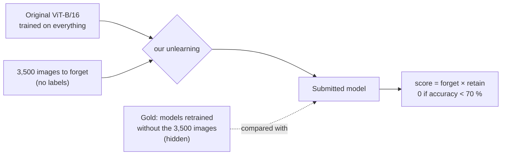
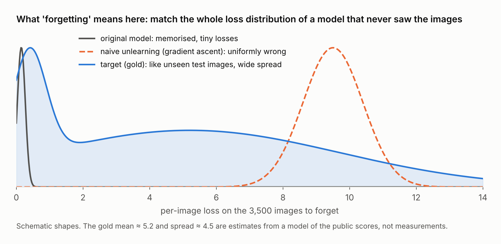
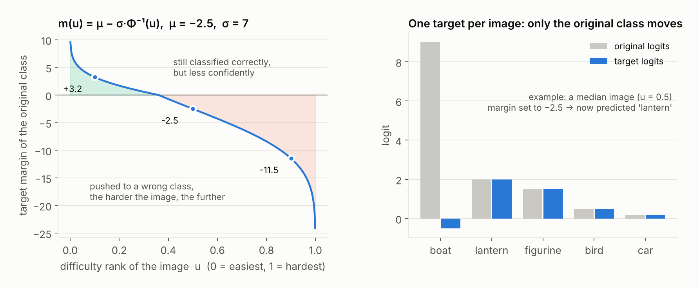
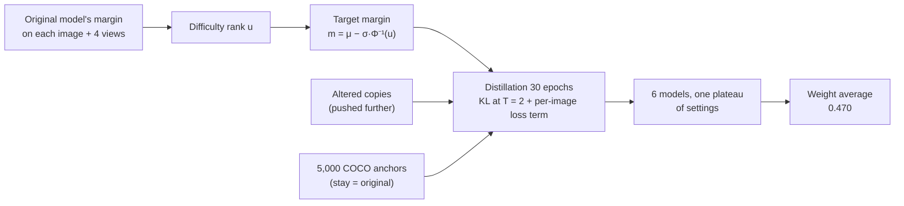
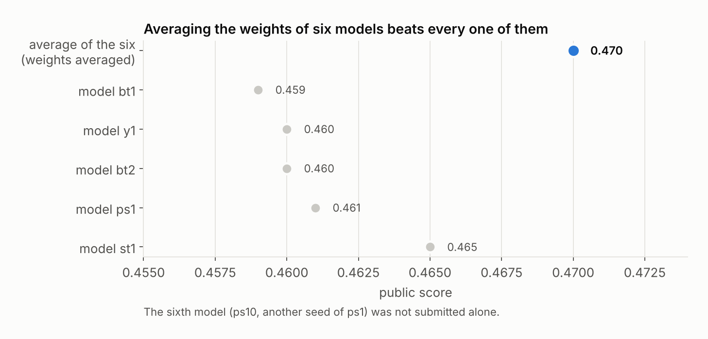
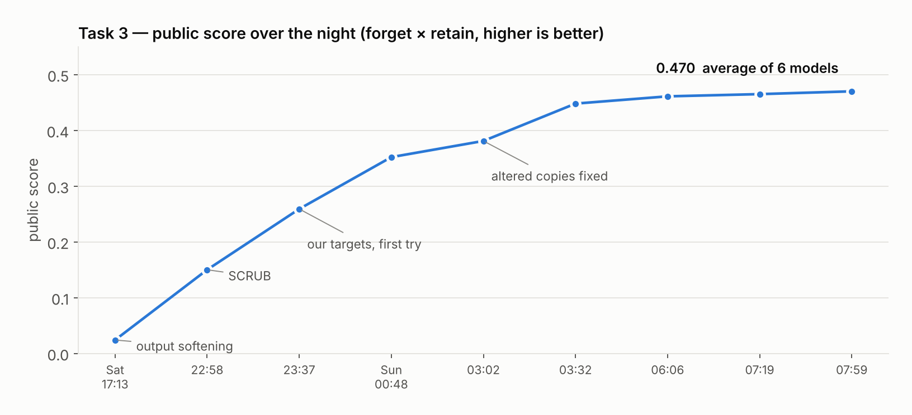

# Task 3 — Has the model really forgotten?

**Public score 0.470** (forget × retain) · task statement: [summary](../docs/tasks/task3_unlearning.md) ·
paper it builds on: [SCRUB](../docs/papers/scrub_unlearning.md) ·
method explained: [long version](../docs/explanations/task3_method.md)

> Make an image classifier forget 3,500 of its training images, so that it behaves exactly like a model that never
> saw them — without retraining, without labels, and without breaking anything else.

## The task in pictures



- **Forget**: on the 3,500 images *and* on hidden altered copies of them, the submitted model must have the same loss
  distribution (mean **and** spread) and the same per-image predictions as gold.
- **Retain**: everywhere else, it must stay as accurate as, and as close as possible to, the original model.
- Submitting the original model unchanged scores 0; destroying it scores 0 too.

**The trap.** "Forgetting" does not mean "getting the images wrong". For gold, these 3,500 images are just test
images: it still recognises the easy ones, gets the hard ones wrong, and its losses are widely spread. A model pushed
to be wrong everywhere is as easy to spot as one that remembers everything.



## Our solution

**Idea in three sentences.** On the forget images, gold behaves like a model at test time. So for every image we
build a **target**: the original logits in which only the logit of the original class is lowered — the harder the
image, the more. Then we **distil** towards these targets, on the images and on altered copies of them, while
holding the model in place everywhere else.





How we found it: a **simulator** — a ViT trained from scratch on CIFAR-100, with the same forget-set structure, four
retrained "golds" and the exact scoring — gave us a ground truth to experiment with, without spending submissions.
It showed that setting the margin by difficulty is worth 0.37–0.46 of forgetting there, against 0.04 for simply
softening the outputs.

### Rank-based margin targets — `src/tg.py`

- Original class y = orig's prediction. Difficulty u(x) ∈ [0, 1] = rank of orig's mean margin over the clean image
  and 4 deterministic augmented views (`--rank mv`).
- Imposed margin of the original class: `m(x) = mu − sigma · Φ⁻¹(u(x)) − beta · rho_c`, where rho_c = n_c / max n_c is
  the relative size of the class in the forget set. Logits of the other classes = orig's, scaled by `tb`.
- Selected setting: `mu = −2.5`, `sigma = 7`, `tb = 1.4` (push the other classes slightly apart),
  `--pos_scale 0.5` (positive margins halved: images that gold still classifies correctly are less confident).

### Distillation — `src/k3.py distill`

- 30 epochs, lr 1e-4, start = orig; KL at T = 2 towards the targets **plus a Huber loss on the per-image
  cross-entropy** (`--w_ce 1`; without it the tail of the loss distribution is not reproduced).
- Altered copies of the forget images (crop, flip, colour, blur, noise) — they count for half of the score; their
  margin is lowered by 4.5 more (`--view_delta 4.5`), with 30 % clean images (`--clean_frac`) and 20 % strong views
  (`--strong_frac`).
- Anchors: 5,000 COCO val2017 images, on which the student must keep orig's outputs (KL).

### Weight averaging — `src/k3.py avg`

Six models from the same plateau of settings, all starting from orig, averaged parameter by parameter. Averaging
removes the training noise of each run (±0.006, measured by re-running one setting with another seed) and gives the
real level of the setting: **0.470** versus 0.459–0.465 for each model. Averaging twelve models gave 0.469.

| Model | What distinguishes it | Public score alone |
|---|---|---|
| `ps1` | reference setting (`--pos_scale 0.5`) | 0.461 |
| `ps10` | `ps1` with another seed | not submitted |
| `st1` | 35 % strong views, 25 % clean images | 0.465 |
| `bt1` | class-size dependent margin, `beta = 2`, `mu = −1.1` | 0.459 |
| `bt2` | same, `beta = −2`, `mu = −3.9` | 0.460 |
| `y1` | 30 % synthetic variants (diffusion) treated as copies to forget | 0.460 |



## Results over the night



| Time | Best public | What changed, and why |
|---|---|---|
| 21/11 17:13 | 0.024 | Uniform output softening (T = 8) + COCO anchors: gold is not "less confident everywhere". |
| 21/11 afternoon | 0 (×2) | Head surgery on the 9 "heavy" classes: harmful. |
| 21/11 22:58 | 0.150 | SCRUB folds extrapolated in weight space: forgets little, drifts a lot (anchor agreement 0.61). |
| 22:00–22:30 | — | Restart from scratch. The model was trained from scratch (cosine ≈ 0 with 7 public timm checkpoints); images are diffusion-generated, fine classes grouped in families. |
| 22:40–23:30 | — | **Simulator**: ViT trained from scratch on CIFAR-100, same forget-set structure, 4 golds, exact scoring. It gave the **structure** of the method: set the original-class margin by difficulty rank (0.37–0.46 forget score versus 0.04 for softening), and add the per-image CE loss. |
| **23:37** | **0.259** | First k3 submission. |
| 22/11 00:48 | 0.352 | Margin calibration: optimum near mu −3, sigma 7. |
| 02:33 → 03:02 | 0.381 | The student forgot **less** on altered copies (loss 3.18 on a crop, 4.01 on a flip, versus 4.58 on the clean image) whereas gold loses rather more there. Fix: `--view_delta` + 70 % views. |
| 03:21 → 03:32 | 0.448 | Stop squeezing the other classes' logits (`tb 1.0`: 0.431), then push them apart (`tb 1.4`). The simulator said the opposite: its fine settings do not transfer. |
| 03:51 → 05:56 | — | Axis-by-axis check: local optimum (mu −1.5: 0.419; −3.5: 0.375; 50 epochs: 0.403; 20: 0.429). Noise measured at ±0.006. |
| 06:06 | 0.461 | `--pos_scale 0.5` (`ps1`). 0.3: 0.456; 0: 0.437. |
| 07:19 | 0.465 | 35 % strong views (`st1`), within noise. |
| **07:59** | **0.470** | **Weight average of six plateau models (`plat6`).** |

What we learned about the problem:
1. Gold is "at test time" on the forget images: a simple model of the score, fitted on seven submissions, puts its
   mean loss around 5 ± 4.5.
2. Gold knows every class, including the 9 classes with 130 forget images each (`h1` 0.138 versus 0.346).
3. The 70 % barrier is far: disabling 3 classes costs only 5 % of the score.
4. Altered copies count for half, and a naive student forgets less on them than on the clean image.
5. Touching only the original-class logit is enough: squeezing the other logits hurts, spreading them helps.
6. Retention is a structural cost: on the simulator, neither in-domain anchors, adversarial negatives nor parameter
   subsets raise it by more than 5 %.

## What did not work

| Idea | Verdict | Measurement |
|---|---|---|
| Uniform output softening | insufficient | 0.024–0.027 public |
| Head surgery on the 9 heavy classes | harmful | 0.0 (two tries) |
| SCRUB folds as targets, extrapolated | superseded | 0.15; strong drift |
| Neighbour-purity difficulty ranking (mid-layer features) | does not transfer | better on the simulator, −9 % on the real task |
| Gold never saw the 9 heavy classes | refuted | `h1` 0.138 vs 0.346 |
| Squeezing the other logits (tb 0.8) | harmful | 0.381 vs 0.431 (tb 1.0) |
| 50 or 20 epochs instead of 30 | worse | 0.403 and 0.429 vs 0.448 |
| Zero margin for correctly classified images (`--pos_scale 0`) | worse | 0.437 vs 0.461 |
| Strong views kept equal to orig | worse | 0.427 |
| Same wrong class for all copies of an image | harmful | 0.345 |
| Fisher-weighted penalty (certified removal) | no effect | simulator 0.361 vs 0.360 |
| Synthetic variants as in-domain anchors | harmful | 0.400 |
| 50 % strong views | slightly worse | 0.451 |

Lesson: any protection placed close to the forget images (strong views kept, near variants as anchors) prevents
forgetting from spreading to their transformed versions, which count for half of the score.

## Limits

**What the targets assume.** The margin rule `m(x) = mu − sigma · Φ⁻¹(u(x))` is a quantile transform: images are
ranked by difficulty and given the quantiles of a normal law N(mu, sigma²), so the imposed margins follow that law in
the order of difficulty. With the selected `mu = −2.5`, `sigma = 7`, the share of forget images whose imposed
margin stays positive is P(m > 0) = Φ(mu / sigma) = Φ(−0.36) ≈ **0.36** — the targets
implicitly treat gold as a model with a test accuracy of roughly a third on these images. This number was never
measured; it follows from settings tuned on the public score.

**What comes from reasoning and what comes from the leaderboard.**

| Part | Origin |
|---|---|
| "Forgetting = behaving at test time", rank-based margins, per-image CE term, lowered margin on altered copies, COCO anchors, weight averaging | simulator (known gold), a local diagnostic (`view_stats`), the scoring formula, measured training noise |
| Values of `mu`, `sigma`, `tb`, `view_delta`, `pos_scale`, number of epochs, share of strong views | axis-by-axis search on the public score (92 team submissions in total) |
| "Gold's loss on the forget images is about 5.2 ± 4.5" | a simple model of the score fitted on seven public scores |

The simulator gave the structure but not the fine settings: it pointed the wrong way for `tb` and for the
neighbour-purity ranking.

**Why the leaderboard tuning should transfer, and its limit.**
- The tuned quantities are a handful of **global** settings applied to every image, not per-image decisions: few
  degrees of freedom to fit the noise of the public part.
- Public (about 30 %) and final (about 70 %) scoring data are split by a hash of each image identifier, so both are
  drawn from the same population.
- Limit: the best public scores (0.461, 0.465, 0.470) differ by about the training noise (±0.006), and the
  sampling noise of a 30 % evaluation subset was not measured. Choosing the best of many submissions favours the
  luckiest one, so the final score may be somewhat lower. The weight average is the least exposed choice: it does not
  depend on one lucky run.

## Code map

| Path | Role |
|---|---|
| `config.env` | paths, GPUs, submission URL — the only file to edit |
| `run_all.sh`, `steps/` | the pipeline, one script per step |
| `slurm/run_all.sbatch` | example batch script for a 4-GPU node |
| `src/task_template.py` | official template: ViT builder, server preprocessing, data loading |
| `src/prepare_anchors.py` | COCO anchors |
| `src/gen_variants.py`, `src/merge_variants.py` | synthetic variants (sd-turbo) and shard merging |
| `src/tg.py` | rank-based margin targets |
| `src/k3.py` | real environment, augmented views, distillation (`distill`), weight averaging (`avg`); also contains the simulator and out-of-fold modes, not used here |
| `src/submit.py` | submission with server rate-limit handling |
| `results/` | scores of every model in `plat6` and the final submission |

## Reproducing

<details>
<summary><b>Quick start</b></summary>

```bash
cd task3
pip install -r requirements.txt            # torch, timm, numpy, requests (+ diffusers, transformers for step 02)
$EDITOR config.env                         # T3_WORK (must contain model.pt and forget_images.npz), COCO_DIR, GPUS
bash run_all.sh                            # steps 01-04 -> $T3_WORK/models/plat6.pt
bash steps/05_submit.sh                    # optional: submit (needs T3_API_KEY)
```
Hardware used: one node with 4 × A100 (JURECA-DC). Each of the six models takes about 6 minutes on one GPU;
step 02 takes about 2 minutes on 4 GPUs. `slurm/run_all.sbatch` is an example batch script.

</details>

<details>
<summary><b>Pipeline, step by step</b></summary>

| Step | Script | Output (in `$T3_WORK`) |
|---|---|---|
| 01 | `steps/01_prepare_anchors.sh` → `src/prepare_anchors.py` | `anchors.npz` (5,000 COCO images, 224 px) |
| 02 | `steps/02_synthetic_variants.sh` → `src/gen_variants.py`, `src/merge_variants.py` | `k5/syn_s0.5.npz` (2 variants per forget image; used by `y1` only) |
| 03 | `steps/03_train_models.sh` → `src/tg.py`, `src/k3.py distill` | `targets/<name>.pt`, `models/<name>_a1.0.pt`, `logs/` |
| 04 | `steps/04_weight_average.sh` → `src/k3.py avg` | `models/plat6.pt` (submitted file) |
| 05 | `steps/05_submit.sh` → `src/submit.py` | server response, `output/submit_log.txt` |

The options in step 03 are those of the hackathon runs, read from the logs of the job queue that produced the six
models; those raw logs are not part of this repository. Each distillation prints its own local statistics (accuracy
and loss on the forget images, agreement and KL on the anchors), which is what we compared during the night.

</details>

<details>
<summary><b>Notes on reproducibility</b></summary>

- Training uses random augmentations and bf16: a re-run lands within about ±0.006 of each single-model score; the
  average is more stable.
- Two steps were reconstructed for this repository: merging the variant shards (`src/merge_variants.py`, a one-off
  command during the hackathon) and the targets of `y1` (no `tg.py` log exists for it; the step copies the targets of
  `ps1`, which has the same target options).
- Changes to the hackathon code: working directory read from `$T3_WORK` (`k3.py`, `gen_variants.py`, `submit.py`),
  key and URL read from the environment (`submit.py`). Options added to `k3.py` after `ps1` (`--ewc`, `--syn_frac`,
  `--llrd`, `--ema`, `--others_src`) are inactive by default. Inline comments in the code are in French (the team's
  working language).

</details>
